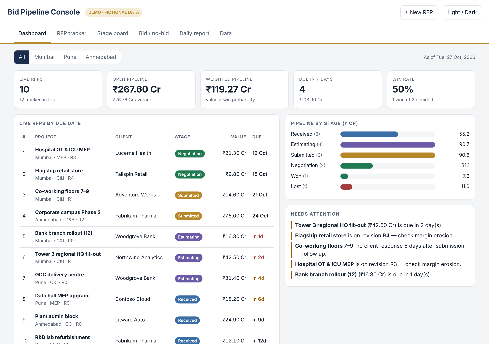
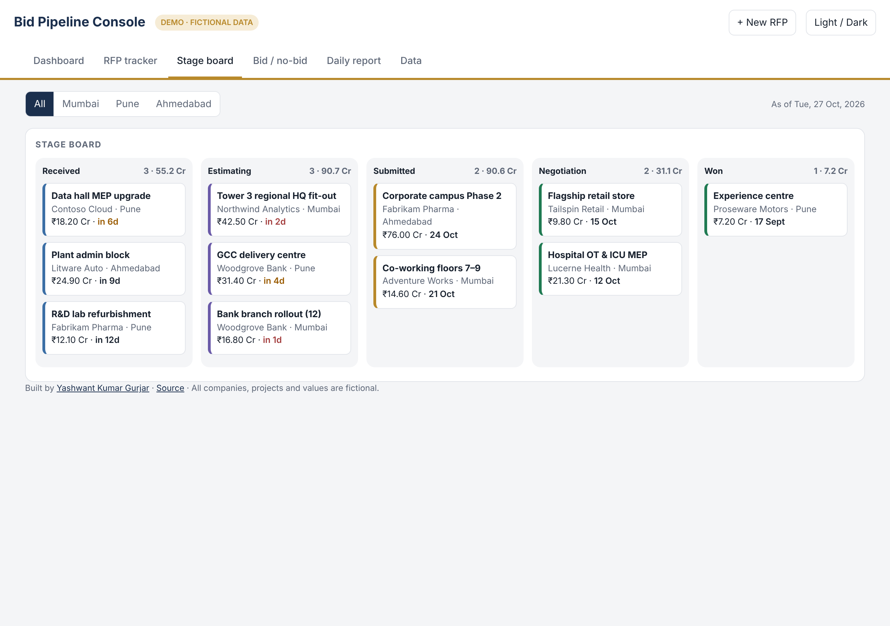
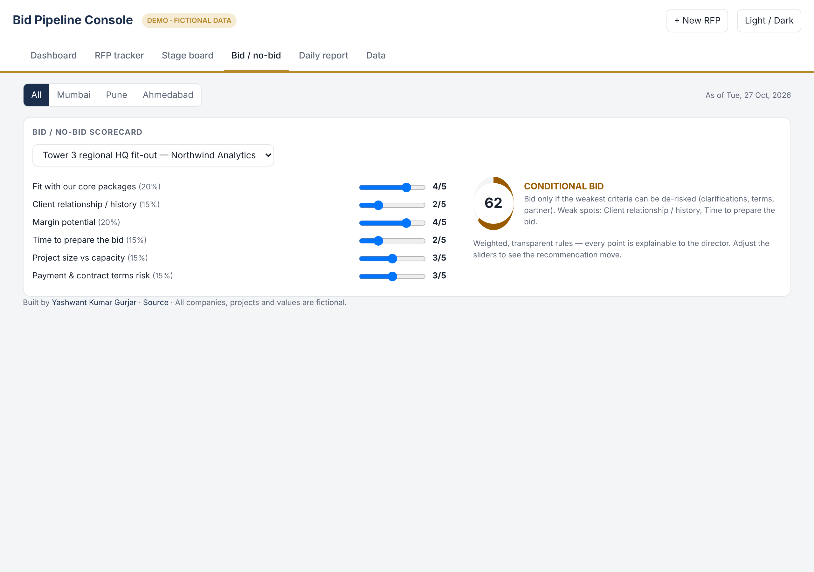
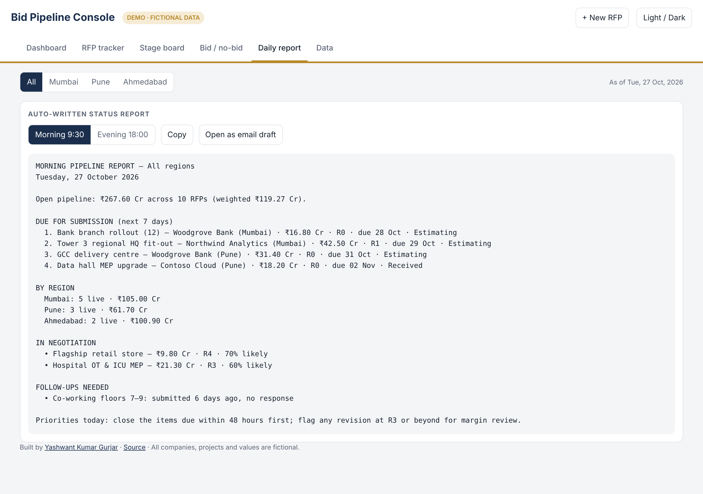

# Bid Pipeline Console

**One screen for a regional director to see every live tender — value, stage, deadline, revision, bid/no-bid call — and a status report that writes itself.**

**▶ Live demo: [yashkasana1996.github.io/bid-pipeline-console](https://yashkasana1996.github.io/bid-pipeline-console/)** (fictional data — add, edit and drag RFPs freely; it all stays in your browser)

   

---

## The problem

A design-and-build firm's regional office runs dozens of tenders at once across several cities. The data exists — but it lives in estimators' spreadsheets, email threads and people's heads. So every morning and evening someone phones around, rebuilds a tracker by hand and types a status report for the director. Deadlines slip through, revisions pile up unnoticed, and no one can say what the pipeline is actually worth today.

## What the console does

| View | What you get |
|---|---|
| **Dashboard** | Live RFPs, open and probability-weighted pipeline (₹ Cr), what's due in 7 days, win rate; due-date table with totals; pipeline by stage; an automatic *Needs attention* list (overdue estimates, submissions with no response, revisions at R3+) |
| **Region filter** | Every number, table and report recalculates per city in one click |
| **RFP tracker** | Sortable register with revision (R0–R5), area, ₹/sq ft, win %, owner and a totals row; click any row to edit |
| **Stage board** | Kanban from *Received* → *Estimating* → *Submitted* → *Negotiation* → *Won*; drag a card to move it |
| **Bid / no-bid** | Transparent weighted scorecard (fit, relationship, margin, time, capacity, terms risk) → **Bid / Conditional / No-bid** with the weak spots named |
| **Daily report** | Morning (9:30) and evening (18:00) reports generated from the data — copy, or open as an email draft |
| **Data** | Export / import JSON to move between machines; nothing is sent anywhere |

| Stage board | Bid / no-bid scorecard | Auto report |
|---|---|---|
|  |  |  |

## Why it's built this way

- **Shaped around how the director already thinks** — regions, ₹ Cr, revisions, "what's due this week" — not around a generic CRM. That's what made the original get used every day.
- **Zero install, zero IT ticket.** One HTML file that runs offline on any laptop; data persists in the browser and exports to JSON.
- **Rules you can explain.** Scoring and alerts are plain, visible logic, so the director can challenge any recommendation.

## Background

I built the original version in my role supporting a City Director at a design-and-build firm, where it replaced the full-day manual effort of compiling pipeline reports. This public version is a clean rebuild with invented companies and numbers — no client data.

## Run locally

Download `index.html` and open it in any browser. That's it.

---

Built by **Yashwant Kumar Gurjar** — I design and build AI tools for operations-heavy businesses.
[Portfolio](https://yashkasana1996.github.io) · [LinkedIn](https://linkedin.com/in/yashwant-gurjar96) · yashkasana6991@gmail.com
